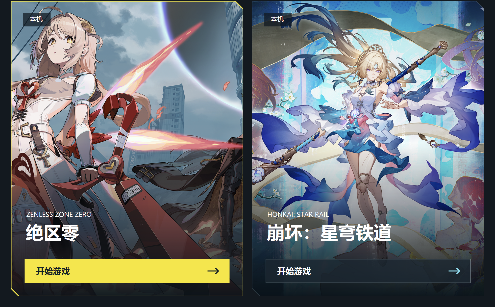

# Zenless Steam Bridge · 绝区零 / 崩坏：星穹铁道

通过 Steam 启动已有的国服客户端，无需下载 Steam 国际服。启动后可通过卡片选择游玩的游戏。

本项目基于 [SoledadAki/endfield-steam-bridge](https://github.com/SoledadAki/endfield-steam-bridge)，使用 **ChatGPT 6.1 Sol** 辅助修改，将原项目的双游戏启动适配为《绝区零》与《崩坏：星穹铁道》。感谢原作者的设计与开源贡献，本项目保留原项目的版权声明与 MIT 许可证。

**版本**：官服绝区零 + 官服崩坏：星穹铁道

## 下载 v0.2.2

请在本仓库的 **Releases** 页面下载 `ZenlessSteamBridge-0.2.2-dual-win-x64.zip`，完整解压后运行 `ZenlessSteamBridge.exe`。压缩包同时包含程序、使用说明与完整源码。

## 使用方法

使用流程沿用原项目，游戏入口与客户端路径调整为本版本对应的游戏。

1. 登录 Steam，将《绝区零》加入游戏库；安装并登录对应的国服官服客户端。
2. 退出游戏和米哈游启动器，解压程序包，以管理员身份运行 `ZenlessSteamBridge.exe`。
3. 确认客户端路径：绝区零选择 `ZenlessZoneZero.exe`，崩坏：星穹铁道选择 `StarRail.exe`。未自动识别时可手动选择；至少设置一款游戏。
4. 首次使用点击“载入双游戏”，等待 Steam 重启。
5. 从 Steam《绝区零》开始游戏，在卡片界面选择“绝区零”或“崩坏：星穹铁道”，即可启动对应的国服官服客户端。

两款游戏统一使用 Steam《绝区零》入口，游玩时长与截图均归入 Steam《绝区零》。游戏更新仍通过米哈游启动器进行。

已载入旧版、更新组件或更换游戏路径时，退出游戏后打开新版，点击“修复启动入口”。需要恢复原有 Steam 设置时，点击“撤回载入”。“预览选择界面”仅预览卡片；关闭选择窗口或按 Esc 会取消启动。

## 演示



## 环境与源码

与原项目采用相同的运行环境：**Windows 10/11 x64，.NET Framework 4.8**。代码使用 **MIT 开源协议**。

完整源码随发布压缩包提供，位于 `source/` 文件夹；构建与测试方式沿用原项目，在源码目录中分别运行 `build.ps1` 与 `test.ps1`。打包可运行 `package.ps1`。

```powershell
powershell -ExecutionPolicy Bypass -File .\build.ps1
powershell -ExecutionPolicy Bypass -File .\test.ps1
powershell -ExecutionPolicy Bypass -File .\package.ps1
```

发布包的主程序可直接运行，无需安装 Python、Node.js 或 Mono。详细实现、故障排查及 Linux 交叉构建方法见 [技术说明](docs/TECHNICAL.md)，测试记录见 `VALIDATION.txt`。

## 来源与许可

- 原项目：[SoledadAki/endfield-steam-bridge](https://github.com/SoledadAki/endfield-steam-bridge)。本次修改基于原项目 v0.2.4，保留原作者版权声明与 `LICENSE`。
- 修改方式：通过 **ChatGPT 6.1 Sol** 辅助修改，适配绝区零与崩坏：星穹铁道双游戏启动。
- 游戏名称、商标及宣传图归米哈游 / HoYoverse 与相应权利人所有，不属于代码的 MIT 授权范围；图片来源记录见源码中的 `assets/SOURCES.json`。
